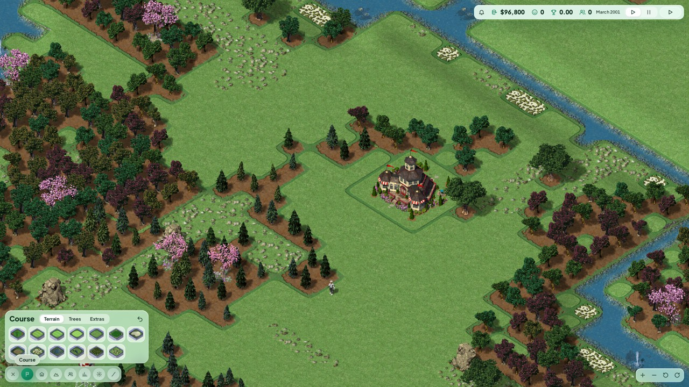
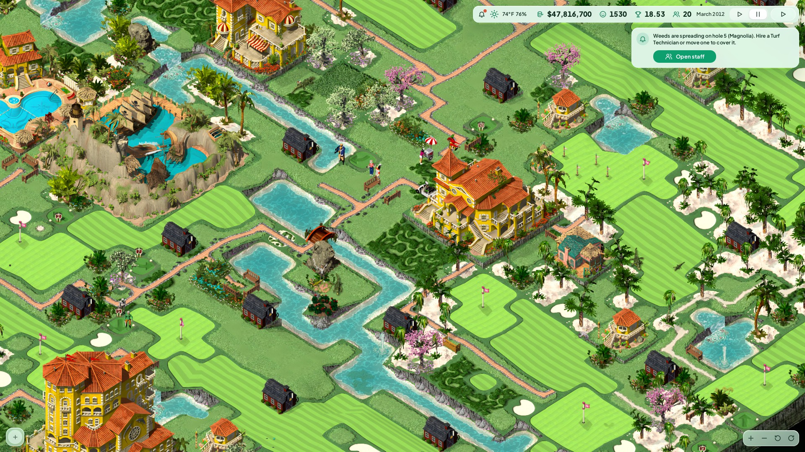
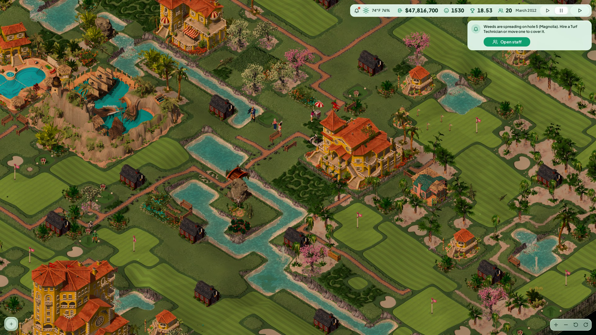
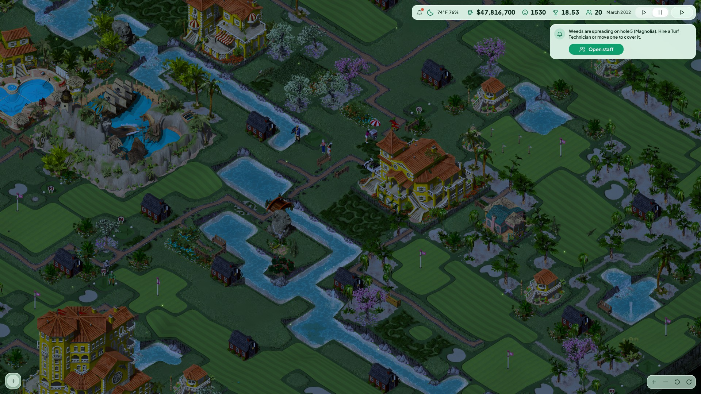
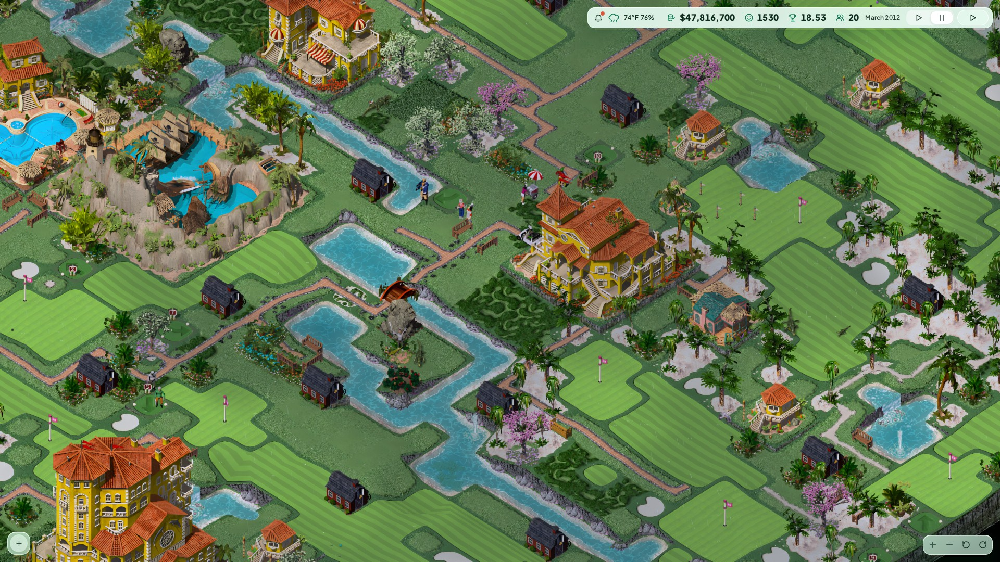
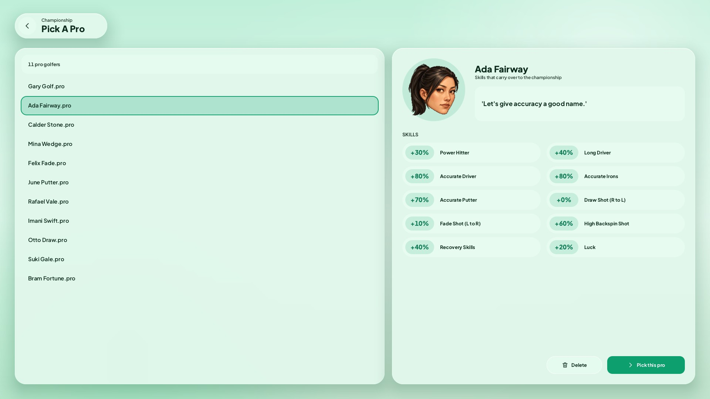
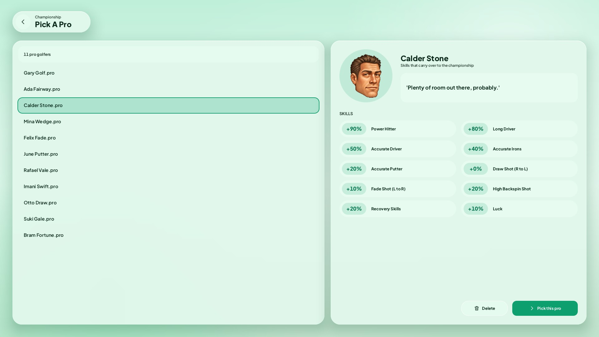
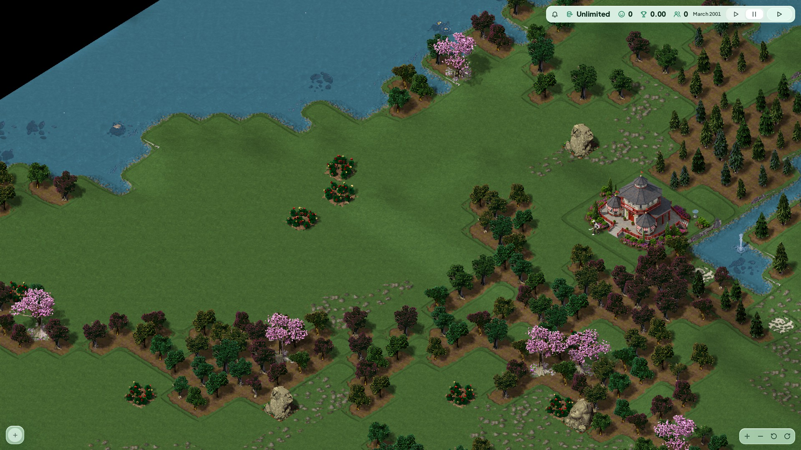

# SimGolf Remastered for Windows

[](https://ko-fi.com/finalpantasy)

A fan-made upgrade of **Sid Meier's SimGolf** (Firaxis / EA, 2002) for Windows PCs.
It runs your own copy of the game as a modern program: sharp at 1080p, 1440p
and 4K, widescreen, smooth scrolling and zoom, a cleaner look for the menus and
course HUD, an Options page, and a way to change the game with mods.

Includes **45 additional golfer identities and portraits**, Living Club personalities,
an optional **day/night lighting and regional weather system**, and the new Parkland clubhouse.

This download contains **no game files**. You bring your own copy of the game
(an installed game folder or disc image, and the version 1.02 no-CD `golf.exe`); the installer prepares
it on your PC and nothing from it ever leaves your computer.



[Download for Windows](https://github.com/finalpantasy/simgolf-mod/releases/latest) | [Installation help](INSTALL.md)

Version **0.1.32** improves save-file safety, prevents a low-memory artwork-cache crash, lists recent saves first, stops menu rain, and restores missing report information. It retains the 0.1.31 championship path-search fix. See the [changelog](CHANGELOG.md) for details.

## New features and improvements over vanilla

### Mod settings in the game

Select a mod and use the green **Configure** button to change named settings, with guidance on when each choice takes effect. Settings save automatically; disabled mods and the Vanilla profile keep their original behavior.

### Bigger courses and more staff

- **Up to 10x the land:** choose Original (50 x 50 tiles), Bigger (70 x 70), Large (100 x 100) or Huge (158 x 158) when starting a course. Terrain, scenery and wildlife scale with the map, and saves keep their course size.
- **Larger staff teams:** keep the original limit of 20 paid staff or raise it to 100 in Options. Expanded teams are stored in game and course saves.

### Modern visuals

- **1080p, 1440p, 4K and ultrawide (21:9)** support, with windowed or borderless full-screen play.
- **Optional HD art:** the game's original artwork upscaled 4x, including golfers, buildings, trees, terrain, animals and effects. Setup can download the separate pack, about 2.6 GB. Choose **HD**, **Pixel HD** or **Original** textures.
- **Sharp legacy text:** original and modern font choices are rendered at display resolution, including classic construction labels and the original HUD.
- **Frosted Mint interface:** redesigned menus, loading screens, course controls, dialogs, golfer cards and reports, with readable modern text.
- **Frame rate choices:** 60, 120, 144, 240 or uncapped, plus v-sync.
- **A shaded HD golf ball** with golfer-specific colours and a fading flight trail. Ball size, colours and trail are adjustable.
- **Rendering improvements:** water on slopes, waterfall spray, scenery visibility at distant zoom levels and HD shadows.

### Faster loading

- **Faster startup and new courses:** fewer loading pauses and repeated terrain calculations, with a smooth progress bar.
- **Original results preserved:** the same course generation and full-quality artwork, with original loading paths available through the performance settings.

### Smoother controls

- **Smooth camera movement** with mouse-wheel zoom toward the pointer, WASD panning and middle-mouse dragging.
- **Adjustable game speed**, mouse settings and key bindings, with Original and Modern control presets.
- **A clear course view:** adjustable golfer names, optional HUD hiding and the ability to hide terrain trees and scenic palms. Original controls remain available.

### Easier course building

- **Remastered construction controls by default:** the combined Course palette includes path-material and lamp pickers. The original wheel and Course/Buildings trays are an optional choice in Options, with modern top stats and optional HD panel artwork.
- **Optional joined pot bunkers** with connected sand, rounded edges and a steep outer rim. Off by default.
- **18 cosmetic path materials** in the modern picture picker, preserved with saved courses.
- **Six optional course-light designs** with saved placement and day/night artwork. Enable the lamps separately and use the modern palette to select them.
- **Optional click-and-drag construction:** terrain rectangles and L-shaped paths keep the original per-tile prices and placement rules. Single placement remains the default.
- **Picture-based design choices** for benches, flower beds, landmarks, scenic trees and bridges.
- **Rotate controls** for greens and the clubhouse, plus camera-aligned placement outlines and lighter path shading.
- **Repeated placement** for landmarks and scenic bridges, with an option to return to single placement.
- **Home Site details** show lot value, clearing and preparation costs, and profit in the modern placement card.
- **Automatic or manual clubhouse placement** when starting a career.

### Golfers, your pro and reports

- **Golfer names on hover**, lighter thought bubbles and mood faces.
- **Golfer cards** with mood bars, scores, recent comments and profile information.
- **People lists:** see each golfer's mood and current hole, jump to them, and hire, fire, move or rename staff.
- **Remaining professional goals**, matching pro skill bars and a direct-opponent match scorecard.
- **Modern pro screens** for profiles, skill points, practice, match pairing, accomplishments and Top Ten Designers.
- **Live pro scorecards** with the current stroke count, plus shot choices and flight previews.
- **Clickable notifications** with full messages and shortcuts to the relevant golfer or hole, plus message history.
- **Tabbed reports** for course information, comments, histograph, SGA, finances, roster, best scores and hole stats.
- **A redesigned year-end summary** with a clear Continue button.

### Optional lighting and regional weather

Enable the optional atmosphere mod for warm dawns and golden afternoons, moonlit
nights, moving cloud shade, rain, wet ground and storms with thunder. Regional
weather follows the course's location and season. Lighting adds terrain shading, water reflections
and soft directional shadows while keeping the original course and artwork recognizable.

| Daylight | Golden hour |
|---|---|
|  |  |
| **Moonlight** | **Rain and cloud cover** |
|  |  |

These are actual Windows screenshots with the optional atmosphere enabled. The hour and weather were selected for the pictures; original lighting remains the default. The separate experimental Terrain Mod is not installed.

To try the moving day/night cycle and regional weather, add or update these
values in the existing `[environment]` section of `mods.ini`:

```ini
[environment]
enabled=1
day_night=1
regional_weather=1
gameplay=0
```

Set `enabled=0` to return to the original presentation. Weather effects on ball
rolls and arriving golfers' mood are a separate, **off-by-default** gameplay mod.
Thunder and rain have their own volume setting; lightning can be disabled.
See the [independent mod switches](docs/modding/CORE.md#optional-additions-in-0117).

### More golfers and Living Club

Meet **25 new ordinary visitors, 10 touring pros and 10 fictional celebrities**,
with authored names, portraits and character details. The original cast remains
available. Living Club adds 25 personalities, contextual dialogue, memories and
persistent stories, with extra mood reactions available separately.

| Ada Fairway | Calder Stone |
|---|---|
|  |  |

New ordinary visitors follow **original skill progression by default**. Authored
arrival skill mixes and extra mood reactions are opt-in. Original energy, mood
and weed balance is preserved. The roster, stories and reactions each have
[independent switches](docs/modding/CORE.md#optional-additions-in-0117).

### A new Parkland clubhouse

The new clubhouse includes all four views, animated flags and birdbath water.
Original textures retain the original building.



### Fixes and compatibility

Construction animations, pro-shot controls, Save editing and cancellation,
long welcome messages, theme memory and the Routing Map are repaired. Saves,
custom mods and settings are preserved during updates. Original energy, mood,
weed balance and ordinary visitor skill progression remain the defaults;
optional gameplay changes have independent switches.

### More content and mod support

- **Restored cut content:** enable items already present in the original game files, including the oriental house, dinosaur tar pit and lovers' bench.
- **Community themes:** import compatible story, pro and celebrity ZIPs while keeping stock themes available. See the [installation guide](INSTALL.md#add-a-community-theme).
- **Editable game data:** adjust building prices and income, terrain costs, staff wages, difficulty, starting cash, golfer moods and personalities through text files.
- **Mod folders and profiles** with load order, dependencies and conflict handling. Saves remember their mod setup. Start with [the modding guide](docs/modding/README.md) or [make your first mod](docs/modding/FIRST_MOD.md).

### Setup and updates

- **Guided setup** from your existing SimGolf installation or a disc image, using your own matching version 1.02 no-CD program.
- **In-game update checks:** choose when to download and install an update, with actual download progress, checksum/unpacking status and recovery support.
- **Preserved settings:** updates and setup retain player settings, mod profiles and custom mod files.

Original interface and texture options remain available. The default energy, mood and weed balance follows vanilla SimGolf.

## More screenshots

| | |
|---|---|
|  |  |
|  |  |
|  |  |
|  |  |

## Install in four steps

**Windows 10:** if you downloaded the game archive from the Internet Archive,
extract it with [7-Zip](https://www.7-zip.org/) first. During Setup, choose the
`.iso` or `.bin` inside the extracted folder. Choose the version 1.02 no-CD ZIP
separately; that ZIP can stay zipped. See [INSTALL.md](INSTALL.md) for archive help.

1. Get your game files (see [INSTALL.md](INSTALL.md) for exactly where):
   your existing SimGolf installation folder or disc image, plus your matching v1.02 no-CD program.
2. Download `SimGolf-Remastered-v*-windows.zip` from the
   [Releases page](../../releases) and unzip it (right-click, Extract All).
3. Double-click **Setup.cmd** and answer the questions. Say yes to the HD art
   if you have 3 GB free.
4. Play with the **SimGolf Remastered** shortcut on your desktop.

Full step-by-step help and fixes for common problems are in [INSTALL.md](INSTALL.md).

Ideas and help are welcome: see [CONTRIBUTING.md](CONTRIBUTING.md).

## Good to know

- Your saved games go in the `game\Saved Games` folder inside the install folder.
- To go back to the original look, open **Options** and pick Original textures,
  or edit `golf.ini` (the comments explain every line).
- Windows 10 or 11, 64-bit, a graphics card with OpenGL 3.3 or newer.

## Legal

This is an unofficial fan project. It is not affiliated with or endorsed by
Firaxis Games, Electronic Arts or Take-Two Interactive. SimGolf and its
assets are their property. This project distributes **none** of the game's
files: you supply your own copy. The optional HD art pack is a separate,
unofficial fan-made upscale of the game's own art; it is removed on request
by the rights holders.

The program code in this repository is MIT licensed ([LICENSE](LICENSE)).
It is built on [RichardAtCT/simgolf-web](https://github.com/RichardAtCT/simgolf-web)
(MIT), which translated the decompiled game into C. Third-party pieces keep
their own licences (see [CREDITS.md](CREDITS.md)).

## Support

This is a free hobby project. If you enjoy it and want to help keep it going, you can [buy me a coffee on Ko-fi](https://ko-fi.com/finalpantasy). Thank you!
